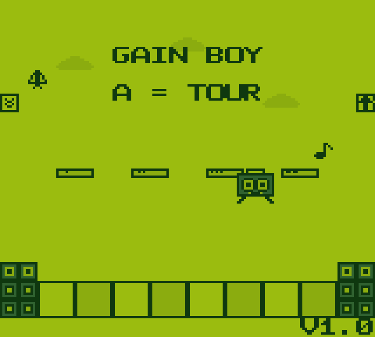
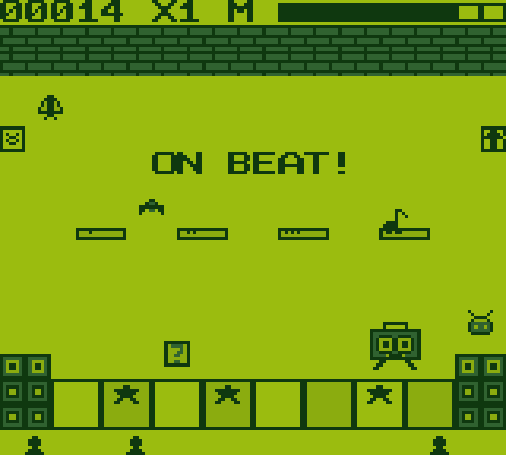
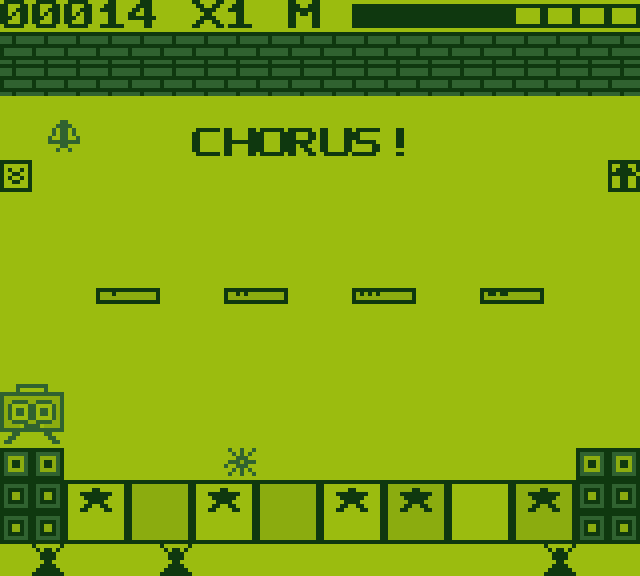

# GAIN BOY

Game Boy music game.


<p align="center">
  
  
  
</p>

- **Play in browser:** [https://benwager.github.io/gain-boy/](https://benwager.github.io/gain-boy/)
- **ROM:** [`rom/gainboy.gb`](rom/gainboy.gb) — DMG / GBC, also RG35XX and other emulators
- **Cart:** MBC1 + RAM + battery (32 KB ROM, 8 KB save)
- **Build:** [GBDK-2020](https://github.com/gbdk-2020/gbdk-2020) 4.5.0 · version 1.0


---

## Controls

| Button | Bouncing | Standing |
|---|---|---|
| ← / → | Walk (land = note) | Walk silently |
| A | Jump; A again in air = double jump to pads | Jump |
| B | Hold = 16th notes | Play current key |
| ↓ | Breakdown (band drops out) | Hold note; walk to glide |
| ↑ | Octave up | Octave up |
| SELECT | Loop last 2 bars for 4 bars | Same |
| START | Pause: Resume / Song / Quit | Same |

Title: **A** = Tour, **START** = Jam.

```
 [BOUNCE]                         [KEY UP]     wall switches
      [pad] [pad] [pad] [pad]                 chord pads
 [ledge]                           [ledge]     power-ups
      [1][2][3][4][5][6][7][8]               piano
      ~~~~~~~~~~~~ crowd ~~~~~~~~~~~~
```

---

## Tour

| # | Stage | Song | Bars | ★ / ★★ / ★★★ |
|---|---|---|---|---|
| 1 | Garage | Sunny | 24 | 80 / 220 / 350 |
| 2 | Club | Night | 24 | 90 / 200 / 320 |
| 3 | Big Stage | Rave | 32 | 100 / 220 / 340 |
| 4 | Arena | Funk | 32 | 150 / 260 / 380 |
| 5 | Stadium | Spooky | 32 | 180 / 290 / 420 |
| 6 | The Moon | Dream | 32 | 220 / 330 / 460 |

One star unlocks the next stage. Crowd mood is the fail state (booed off at 0). Jam = endless free play on the furthest stage unlocked.

---

## Songs & sound (for contributors)

Songs live in [`src/songs.c`](src/songs.c). Each entry is a `Song`: tempo, key, default chord progression, 16-step drum masks, lead voice, echo, and wavetable picks. Patterns are bitmasks — bit *n* is 16th-note step *n* (see the ASCII grids in that file).

How a hit becomes audio is in [`src/sound.c`](src/sound.c):

| Function | Channel | What it does |
|---|---|---|
| `kick()` | pulse 1 | Pitch sweep from `KICK_X` (fake kick drum) |
| `snare()` | pulse 1 + noise | Short tone + noise; optional clap flam |
| `hat()` / `ohat()` / `crash()` | noise | Closed / open / crash |
| `lead()` | pulse 2 | Melody; respects sustain + LONG NOTES FX |
| `wave_note()` | wave | Bass / synth / loops (wavetable from `gen_assets.py`) |
| `echo_push()` | pulse 2 (queued) | Ping-pong delays from the song’s echo fields |
| `strum()` | pulse 2 | Fast-arp chord stab (pads / star power) |

The step sequencer [`src/seq.c`](src/seq.c) fires band patterns and your landings on the 16th grid. Drum-solo kit layering is in [`src/band.c`](src/band.c) (`drum_hit`).

---

## Build

```sh
export GBDK_HOME=/path/to/gbdk
make                  # → rom/gainboy.gb (+ copies into docs/rom/)
make assets           # after editing tools/gen_assets.py
```

Bank 1 (`main` / `songs` / `sound` / `player` / `seq`) is ~98% full; put new code in bank 0 files when possible.

| File | Bank | Role |
|---|---|---|
| `src/main.c` | 1 | Init, main loop, draw helpers |
| `src/songs.c` | 1 | Song table |
| `src/sound.c` | 1 | Channels & harmony helpers |
| `src/player.c` | 1 | Physics, landing, loops |
| `src/seq.c` | 1 | 16th-note sequencer |
| `src/gig.c` | 0 | Tour, score, HUD, pause |
| `src/band.c` | 0 | Power-ups, drum kit, progressions |
| `src/helpers.c` | 0 | Jingles, stage draw, attract |
| `src/save.c` | 0 | Battery save |

Save format: 16 bytes in cart SRAM (high score, rank, stars, songs, tours) + checksum.

---

## License

MIT · Ben Wager · GBDK-2020
